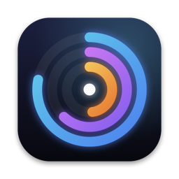
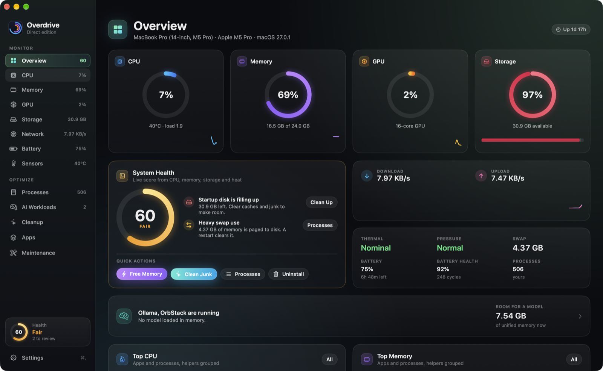
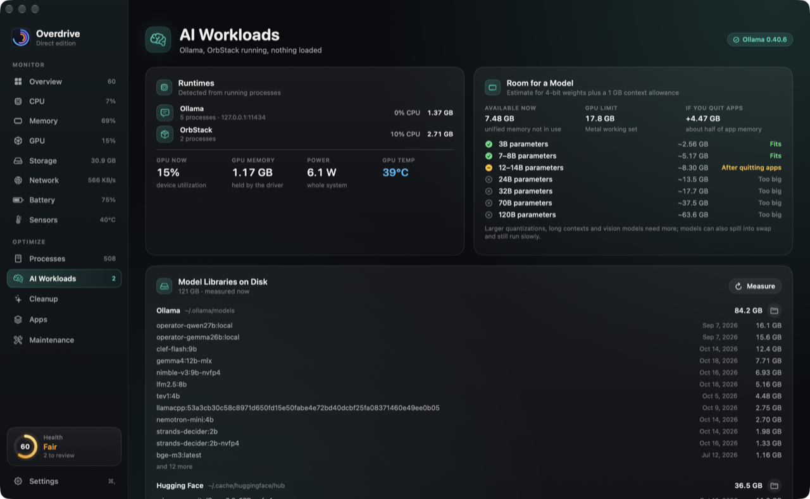
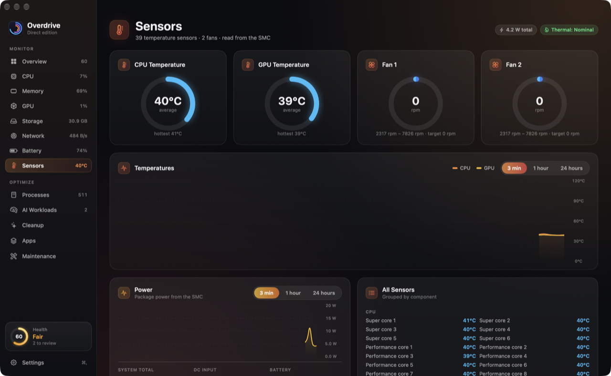
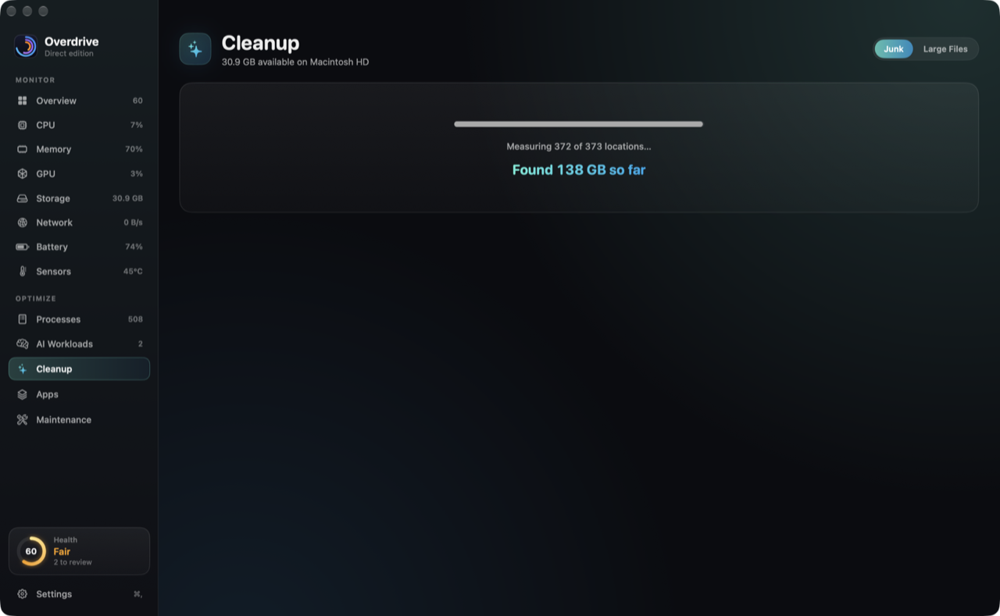
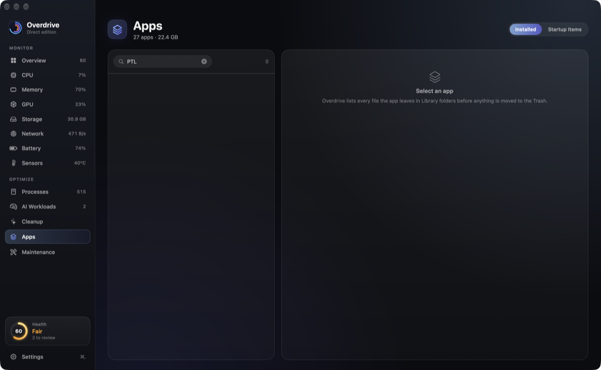
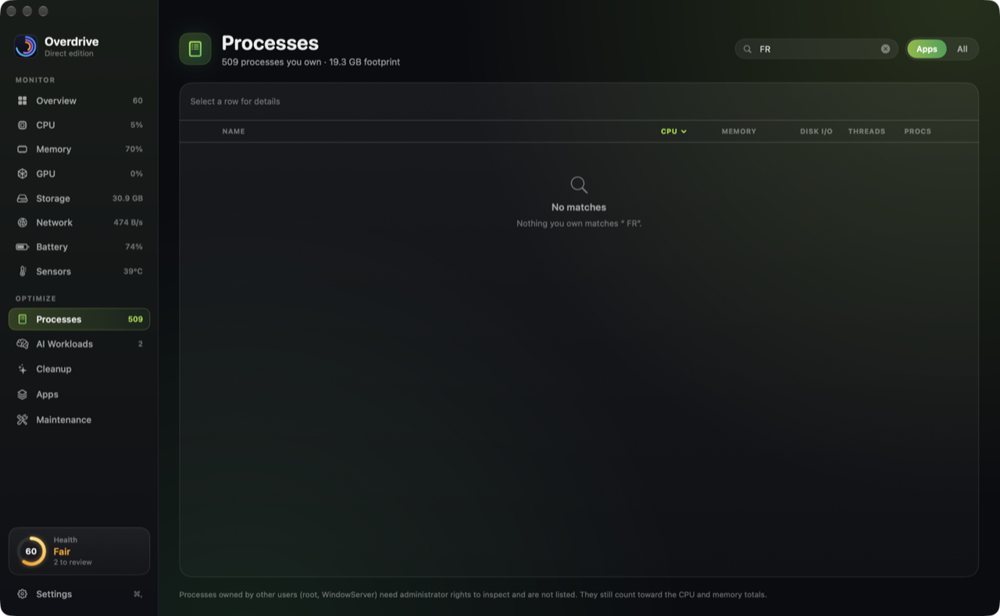
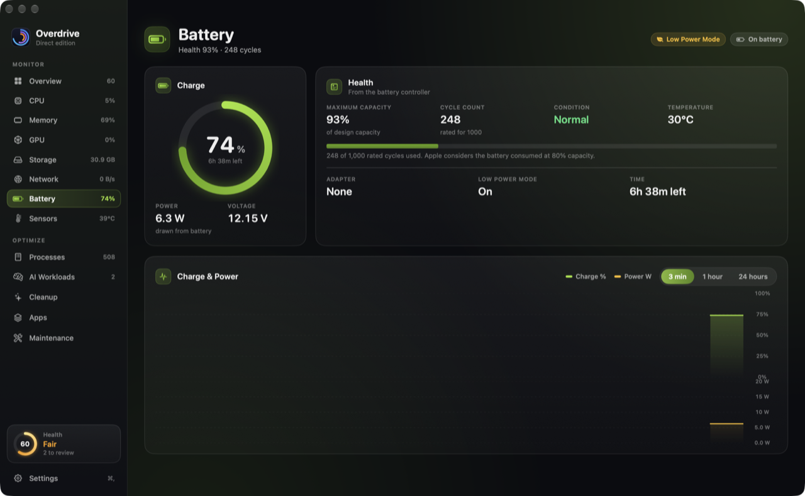
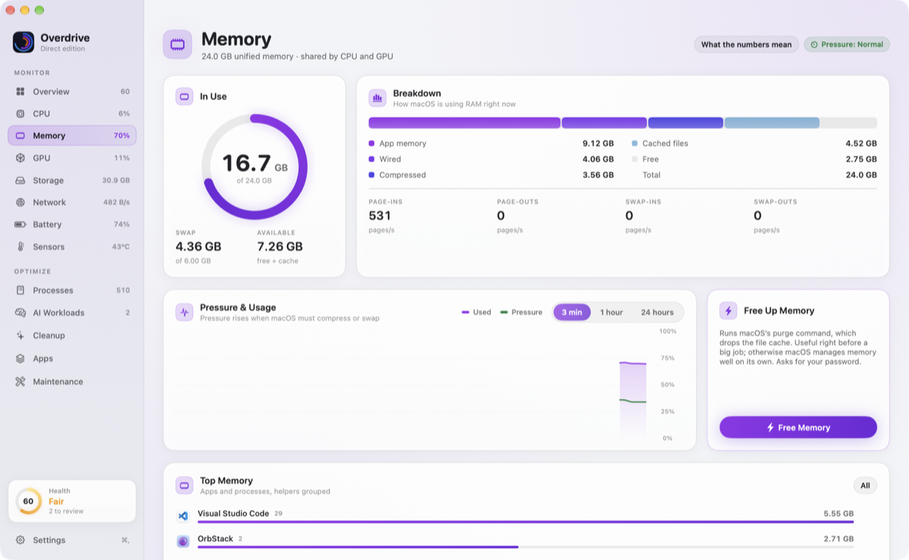
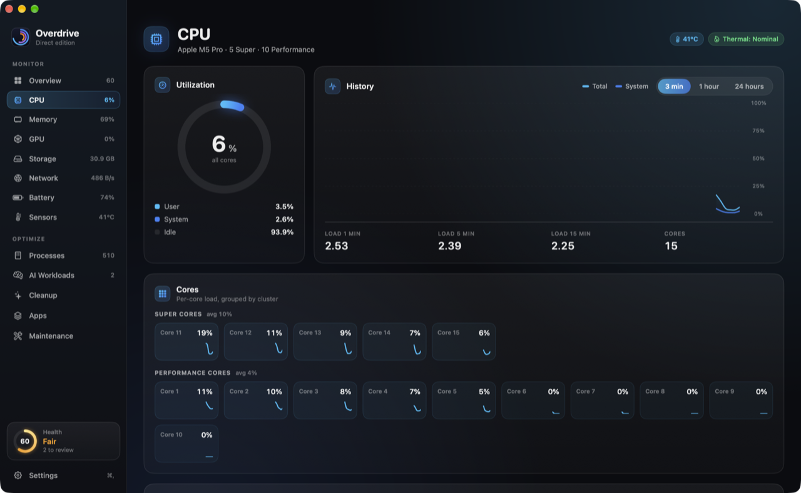

<p align="center">
  
</p>

<h1 align="center">Overdrive</h1>

<p align="center">
  A system monitor and cleaner for the Mac, built for the local-AI era.<br>
  Native SwiftUI. No account, no analytics, nothing leaves your Mac. Free and open source.
</p>

<p align="center">
  <a href="https://github.com/damionrashford/overdrive/releases/latest"></a>
  <a href="https://github.com/damionrashford/overdrive/actions/workflows/ci.yml"></a>
  
  
  
  <a href="LICENSE"></a>
</p>

<p align="center">
  <picture>
    <source media="(prefers-color-scheme: light)" srcset="docs/images/overview-light.png">
    
  </picture>
</p>

## Install

**One line** (downloads the latest release, verifies its SHA-256, installs to Applications, opens it):

```sh
curl -fsSL https://raw.githubusercontent.com/damionrashford/overdrive/main/install.sh | sh
```

**Homebrew:**

```sh
brew tap damionrashford/tap
brew install --cask --no-quarantine overdrive
```

**Download:** grab the DMG from the [latest release](https://github.com/damionrashford/overdrive/releases/latest) and drag Overdrive to Applications. On first launch macOS asks you to allow it once in *System Settings › Privacy & Security*, because the build is signed but not yet notarized by Apple; the two commands above skip that step. Details, checksums, permissions and troubleshooting: [docs/install.md](docs/install.md).

**Build from source:** `brew install xcodegen && scripts/build.sh --install` (Xcode 27). To work in Xcode, `xcodegen generate && open Overdrive.xcodeproj`.

Requires macOS 15 or later on Apple silicon.

## What it does

**See what is actually happening.** CPU per core, grouped by cluster. Memory the way macOS measures it: pressure, app, wired, compressed, cached, swap, with a plain-language explanation of each. GPU utilization and driver memory. Storage with purgeable space. Network throughput that does not double-count VPN traffic. Battery health, cycle count against its rating, charge power and adapter. On the direct edition, temperatures for every CPU and GPU cluster, fan speeds and system power straight from the SMC. Three history ranges (3 minutes, 1 hour, 24 hours) that never grow in memory. A menu bar readout with live graphs and a mini dashboard. Alerts for sustained CPU, memory pressure, low disk space, heat and low battery.

**Fix what is slowing it down.** Processes with helpers grouped under their app, CPU, memory, threads and disk I/O, with a details bar before you quit anything. Cleanup of app caches, logs, Xcode and package-manager junk, the Trash and stale downloads, every item measured and listed before you confirm, with an ignore list. A treemap storage map to see where the space goes. A large-file finder. An uninstaller that finds the files apps leave behind in Library folders. A list of what launchd starts at login. One-click maintenance (free memory, reclaim purgeable space, flush DNS, rebuild Spotlight and Launch Services, reset Quick Look, Homebrew cleanup) through the standard macOS password dialog.

**Built for local AI.** Detects Ollama, LM Studio, llama.cpp, MLX, ComfyUI, Draw Things, Jan, GPT4All and container engines. Shows which models are loaded in memory and what they cost, with a one-click unload for Ollama. Measures model libraries on disk (`~/.ollama`, `~/.lmstudio`, the Hugging Face cache) and finds orphaned Ollama blobs left by interrupted pulls. Tells you how large a model fits in unified memory right now, and what quitting apps would free.

<table>
  <tr>
    <td></td>
    <td></td>
  </tr>
  <tr>
    <td></td>
    <td></td>
  </tr>
  <tr>
    <td></td>
    <td></td>
  </tr>
  <tr>
    <td></td>
    <td></td>
  </tr>
</table>

## Two editions, one codebase

| | Direct (this repository's releases) | Mac App Store |
|---|---|---|
| Monitoring, history, menu bar, alerts | ✓ | ✓ |
| Cleanup, storage map, large files, uninstaller, startup items, AI workloads | ✓ | ✓, after you grant your home folder once |
| Process list with CPU, memory, threads | ✓ | ✓ |
| Quit and force-quit, disk I/O column | ✓ | not permitted by the App Sandbox |
| Temperatures, fans, system power | ✓ | not permitted by the App Sandbox |
| Free memory, flush DNS, snapshots, Spotlight and Launch Services rebuilds | ✓ | not permitted by the App Sandbox |

The same binary runs as either edition; only the entitlements differ. `Capabilities` decides at launch, so the sandboxed build degrades deliberately instead of failing quietly. The App Store listing is pending ([docs/app-store.md](docs/app-store.md)).

## Where the numbers come from

| Metric | Source |
|---|---|
| CPU | `host_processor_info`; clusters from the IODeviceTree (`Super`, `Performance`, `Efficiency`) |
| Memory | `host_statistics64` with Activity Monitor's formula (app + wired + compressed); `vm.swapusage`; the kernel's memory-pressure level |
| GPU | IOAccelerator `PerformanceStatistics` (device, renderer, tiler utilization; driver memory) |
| Storage | `IOBlockStorageDriver` byte counters; `volumeAvailableCapacityForImportantUsage` for purgeable space |
| Network | `NET_RT_IFLIST2` 64-bit counters on physical interfaces |
| Processes | `proc_pid_rusage` (direct) or `proc_pidinfo` (sandbox); helpers grouped by their outermost `.app` |
| Battery | IOPowerSources plus `AppleSmartBattery` (voltage, amperage, cycle counts, design capacity, adapter) |
| Sensors | SMC keys through the public IOKit user client, with per-chip-generation key tables |
| AI | Ollama `/api/ps` and `/api/tags`, LM Studio `/api/v0/models`, both on `127.0.0.1` only; manifests and blobs in `~/.ollama/models`; the Hugging Face hub cache |

Everything is read on your Mac and shown to you. `Overdrive --dump` prints raw samples so you can compare them with `vm_stat`, `top`, `iostat` and `netstat` yourself.

## Privacy

No account, no analytics, no crash reporting, no helper processes, no login item unless you turn it on. The only network requests are to local AI runtimes on `127.0.0.1`, and two opt-in ones that are off by default: a public-IP lookup on the Network page and a weekly release check against GitHub. Your own files only ever go to the Trash. Full policy: [docs/privacy-policy.md](docs/privacy-policy.md).

## Performance

A monitor should not be the thing you are monitoring. Overdrive idles at about 2–3% CPU with the window open and under 1% with it closed, in roughly 150 MB. Settings › General shows its own cost so you can check. The rules that keep it there are in [docs/architecture.md](docs/architecture.md).

## Project

- [Architecture](docs/architecture.md): module map, data flow, rendering budget, safety model.
- [Installing](docs/install.md): Homebrew, DMG, source, first launch, permissions, troubleshooting.
- [Contributing](CONTRIBUTING.md): building, testing, the rules that keep the app honest.
- [Releasing](docs/releasing.md): versioning, changelog, the tag-driven release pipeline, Homebrew tap.
- [Security](SECURITY.md): how to report anything that could touch files it should not.
- [Changelog](CHANGELOG.md).

Built with Swift 6 and SwiftUI, no third-party dependencies. The SMC sensor-key tables follow the community map maintained by the [Stats](https://github.com/exelban/stats) project.

## License

MIT. See [LICENSE](LICENSE).
